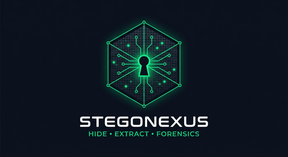
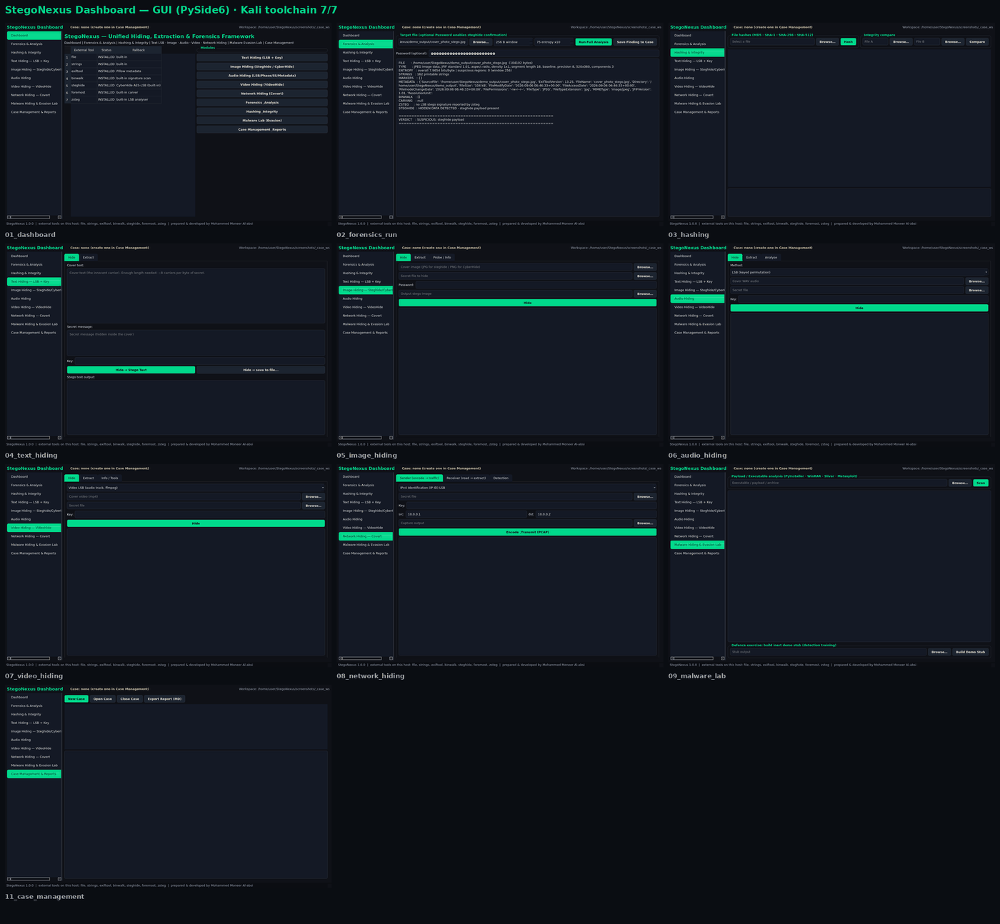
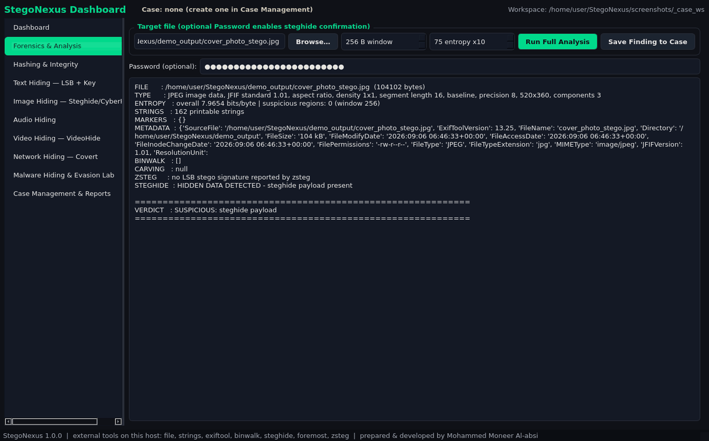
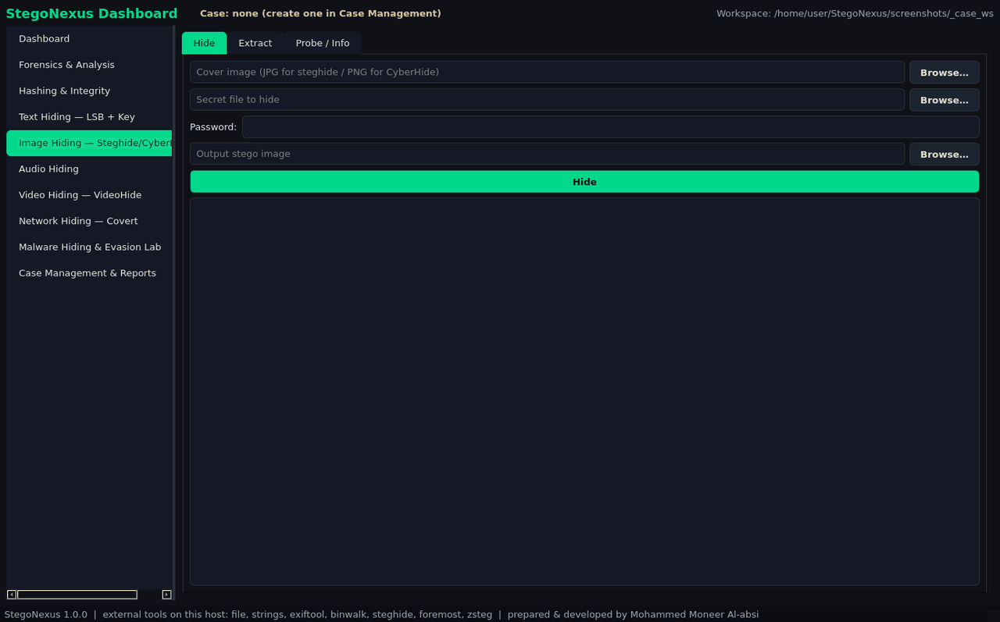
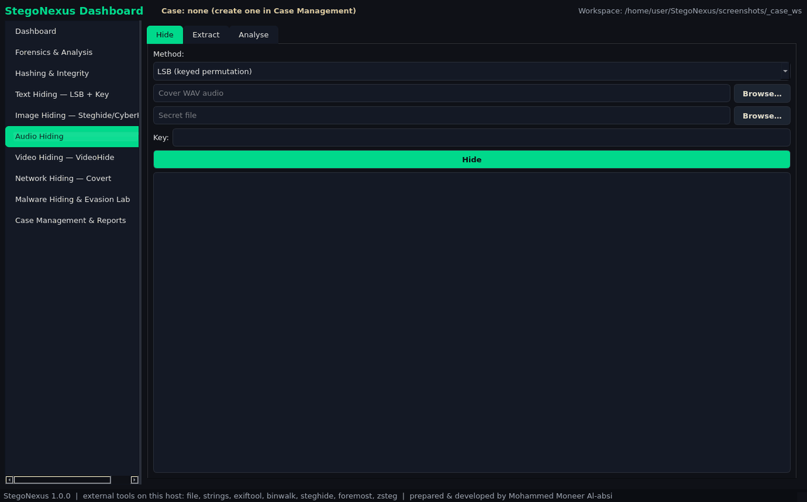
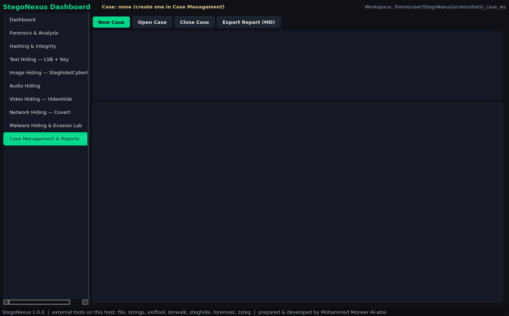

# StegoNexus

<p align="center"></p>

<p align="center">
  <a href="../../actions/workflows/tests.yml"></a>
  
  
  
  
  
</p>

> **Note on repository lineage.** This repository (`Se2`) is the **service-layer
> refactor** of the StegoNexus workbench — 17 modules under `app/modules/` and
> 22 GUI views. The earlier, single-package implementation lives in
> [`ko456123mo-jpg/StegoNexus`](https://github.com/ko456123mo-jpg/StegoNexus).
> See [Repository relationship](#repository-relationship) at the bottom.

A defensive digital-forensics and steganography workbench for **authorized
laboratory and teaching use**.

<p align="center">
  
  
</p>
<p align="center"><sub><b>يميناً:</b> لوحة التحكم الموحّدة · <b>يساراً:</b> تحليل جنائي فعلي لملف</sub></p>

<p align="center">
  
  
  
</p>
<p align="center"><sub>إخفاء في الصور · تحليل صوتي · إدارة قضية وتقارير</sub></p>

> 📸 **29 لقطة شاشة حقيقية** من الأداة تعمل — في [`docs/screenshots/`](docs/screenshots/).
> كل صورة أُخذت من تشغيل فعلي، لا من تصميم واجهة.

<details>
<summary><b>عرض الواجهات الأخرى</b> (7 وحدات + الطرفية)</summary>

| الوحدة | لقطة |
|---|---|
| التحليل الجنائي | [`02_forensics.png`](docs/screenshots/02_forensics.png) |
| البصمات والتحقق | [`03_hashing.png`](docs/screenshots/03_hashing.png) |
| إخفاء في النص | [`04_text_hiding.png`](docs/screenshots/04_text_hiding.png) |
| الميتاداتا | [`05b_image_metadata.png`](docs/screenshots/05b_image_metadata.png) |
| الفيديو | [`07_video_hiding.png`](docs/screenshots/07_video_hiding.png) |
| القنوات الشبكية | [`08_network_hiding.png`](docs/screenshots/08_network_hiding.png) |
| مختبر البرمجيات الخبيثة | [`09_malware_lab.png`](docs/screenshots/09_malware_lab.png) |
| واجهة الطرفية | [`CLISheet_terminal.png`](docs/screenshots/CLISheet_terminal.png) |

</details> StegoNexus analyses, hides, extracts and documents
covert data across text, image, audio, video and network carriers — with a real
case/evidence workflow, hashing, metadata handling, forensic triage, malware
**static** analysis and report generation.

> **Read-only by default.** Original evidence is never overwritten; operations run
> on working or derived copies, and every action is logged to an audit trail.

---

## Features

| Area | What it does |
| --- | --- |
| **Case management** | Create cases, import evidence, chain of custody, findings, audit log |
| **Hashing** | MD5 / SHA-1 / SHA-256 / SHA-512, verify and compare (integrity) |
| **Metadata** | Read / inject / compare / strip via ExifTool (always on a copy) |
| **Forensics** | `file`, `strings`, entropy, `binwalk`, `steghide --info`, `foremost`, `ffprobe`, one-click triage |
| **Text stego** | LSB embedding with a key |
| **Image stego** | Native LSB + Steghide integration (CyberHide documented as reference) |
| **Audio stego** | LSB, phase coding, **native spread-spectrum (DSSS)**, metadata |
| **Video stego** | LSB (lossless containers) + custom EOF container (not OpenPuff) |
| **Network stego** | IPv4 Identification covert channel (encode preview + send/receive) and PCAP interpretation |
| **Malware** | **Static analysis only** — specimens are never executed |
| **Executable stego** | Hide/extract in executables (PE overlay + section slack) + static detection |
| **Reports** | PDF / HTML / JSON case reports |

The GUI never freezes: long operations (binwalk, foremost, ffmpeg, hashing, PCAP,
reports) run on worker threads, and failures surface as *Operation Failed / Reason
/ Suggested Action* instead of raw tracebacks.

---

## Requirements

- Python 3.11+ with `PySide6`, `numpy`, `Pillow`, `cryptography`, `scapy`
- External tools: `exiftool`, `steghide`, `binwalk`, `foremost`, `ffmpeg/ffprobe`,
  `tshark`, `file`, `strings` (optional: `zsteg`, `wireshark`, `audacity`)

Missing tools are reported honestly as **UNAVAILABLE** — the app never fakes a
result.

---

## Install (Kali / Debian)

```bash
sudo ./scripts/install_kali.sh   # forensic tools + Qt runtime libs + .venv + Python deps + zsteg
./scripts/preflight.sh           # verifies every service with a real round-trip
./scripts/run.sh                 # launch the GUI
```

> **PEP 668 note.** Kali/Debian mark the system Python as *externally managed*, so a
> plain `pip install` fails with `error: externally-managed-environment`.
> `install_kali.sh` therefore installs into a project-local **`.venv`** instead of
> touching the system interpreter. `run.sh` and `preflight.sh` use `.venv`
> automatically when it exists.

Manual install (if you prefer to do it yourself):

```bash
sudo apt install -y libimage-exiftool-perl steghide binwalk foremost ffmpeg \
                    tshark file binutils \
                    libxkbcommon0 libxkbcommon-x11-0 libegl1 libgl1 \
                    libglib2.0-0 libdbus-1-3 libfontconfig1 libfreetype6 \
                    python3-venv
python3 -m venv .venv
.venv/bin/pip install -r requirements.txt
.venv/bin/python main.py            # GUI
.venv/bin/python main.py --cli      # command line
```

PySide6 requires **Python >=3.10,<3.15** (3.13/3.14 are fine).

---

## Verifying it really works

```bash
python -m pytest -q                    # regression suite
python scripts/preflight_check.py      # runs EVERY service for real, prints PASS/FAIL
python scripts/demo_end_to_end.py      # end-to-end demo
python scripts/gui_smoke_test.py       # launches and renders all 20 views
python scripts/gui_button_test.py      # clicks every service button and verifies a real result
```

`preflight_check.py` performs true round-trips (the extracted payload is compared
byte-for-byte with the original secret) and writes
`artifacts/preflight/preflight_result.json`.

---

## Network laboratory (important)

Network transmission is **disabled by default**. To use it:

1. Enable **Authorized laboratory mode** in Settings.
2. Run with elevated privileges for the covert IPv4-ID channel (raw sockets):
   `sudo ./scripts/run.sh`.
3. Destinations are restricted to **loopback / RFC1918** addresses.

The baseline UDP transport works without elevated privileges and is explicitly
labelled **not covert** (it is the teaching contrast to the covert channel).

---

## Safety and scope

StegoNexus is a **defensive analysis and teaching tool**. It deliberately does not
and will not:

- execute malware specimens or provide a detonation sandbox;
- steal credentials, establish persistence, bypass UAC/AMSI, or inject code;
- perform destructive operations on evidence.

Malware features are static analysis and clearly labelled simulation only.
Windows-only practical tools (OpenPuff, DeepSound, Coagula) and CyberHide are
documented as **REFERENCE / EXTERNAL**; the custom video EOF container is **not**
OpenPuff-compatible and no such compatibility is claimed.

All sample cases shipped or generated by the helper scripts are labelled
**TRAINING CASE — SYNTHETIC DATA**.

---

## Repository layout

```
app/            application package (gui views, modules/services, steganography engines)
scripts/        install, verification, capture and helper scripts
tests/          pytest regression suite
docs/           documentation (incl. Kali readiness)
resources/      icons and assets
main.py         entry point (GUI / CLI)
```

Generated data (`data/`, `cases/`, `samples/`, `reports/`, `logs/`, `artifacts/`)
is produced at runtime and is not committed; regenerate samples with
`python scripts/seed_samples.py`.

---

## Author

**Mohammed Moneer** — مهندس أمن سيبراني

- 🐙 [@ko456123mo-jpg](https://github.com/ko456123mo-jpg)
- 📧 [moh123mon456@gmail.com](mailto:moh123mon456@gmail.com)

**متاح للعمل الحر:** تحليل جنائي رقمي · كشف البيانات المخفية · بناء أدوات أمنية مخصّصة.

## License

MIT — see [`LICENSE`](LICENSE). Commercial use permitted.

## Security & usage

- [`SECURITY.md`](SECURITY.md) — private disclosure channel and by-design behaviour.
- [`USAGE_POLICY.md`](USAGE_POLICY.md) — allowed/prohibited use and client authorization.

## Repository relationship

This repository **is** the StegoNexus workbench — the actively developed build.
It was previously named `Se2`; the earlier single-package implementation lives on
in [`ko456123mo-jpg/StegoNexus`](https://github.com/ko456123mo-jpg/StegoNexus)
as an archived reference build.

| | Current (this repo) | Archived reference |
|---|---|---|
| Structure | 17 modules in `app/modules/` | 13 modules in `stegonexus/core/` |
| GUI | 22 views | 1 dashboard |
| Tests | 8 files (pytest) | 3 files |
| Status | ✅ active development | 📦 archived — read-only |
| Academic deliverables | `docs/audit/` | `docs/academic/` |
